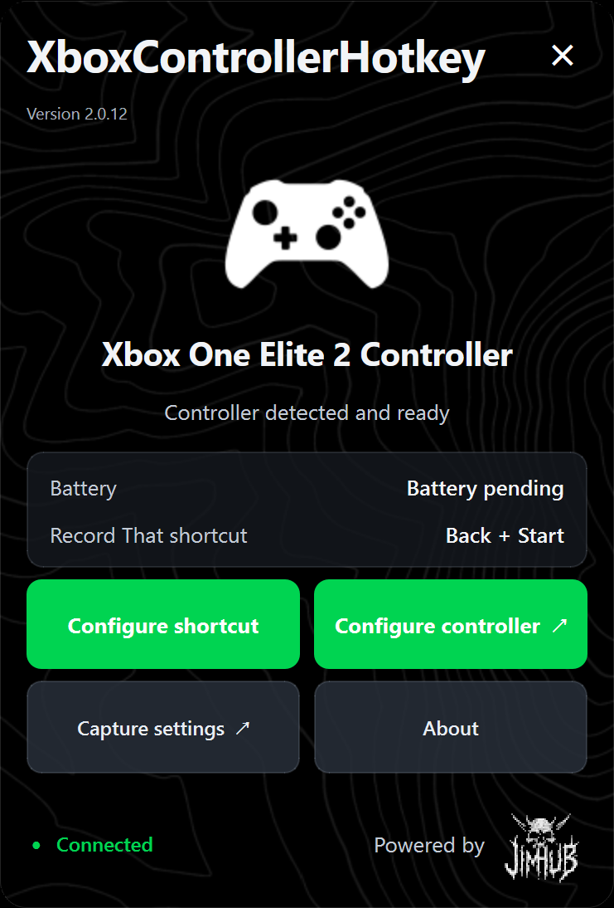
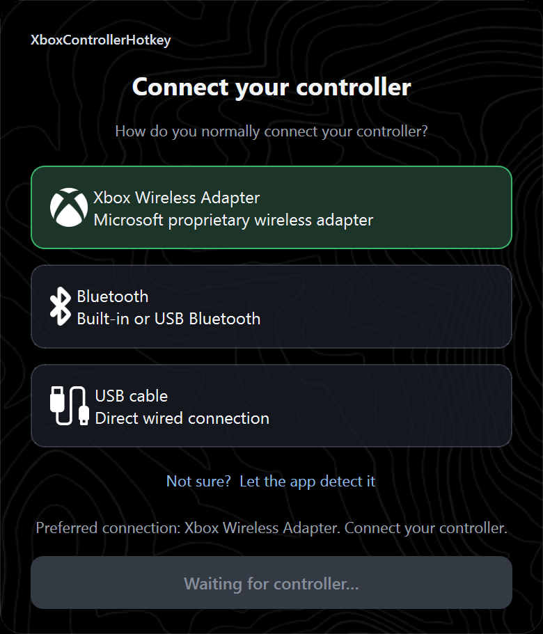

# XboxControllerHotkey

A lightweight Windows application that lets you trigger Xbox Game Bar's **Record That** feature directly from your Xbox controller.

## Screenshots

### Main Application

### Controller Setup

## Features

- Trigger Xbox Game Bar's Record That feature with a configurable controller shortcut.
- Detect, select, and automatically switch between connected Xbox controllers.
- View controller connection and battery information when available.
- Configure controller shortcuts and connection preferences.
- Run quietly from the Windows system tray, with optional startup on Windows.
- Check for and install updates with SHA256 verification.
- Access Windows capture settings and Xbox Accessories from the app.

## Download

Download the latest portable Windows executable from the [Releases page](https://github.com/jimhatesyou/XboxControllerHotkey/releases/latest).

No installer or separate Python installation is required.

## Requirements

- Windows 10 or Windows 11
- Xbox Game Bar installed and enabled
- A compatible Xbox controller

XboxControllerHotkey sends the configured shortcut to Xbox Game Bar. Recording duration, video quality, audio capture, and save location are controlled by Windows Game Bar settings.

## Source Code

The V2 application source is available in the [v2 folder](v2/). The original V1 command-line source is preserved in the repository history and root files.

## License

See [LICENSE](v2/LICENSE).
